<p align="center">
  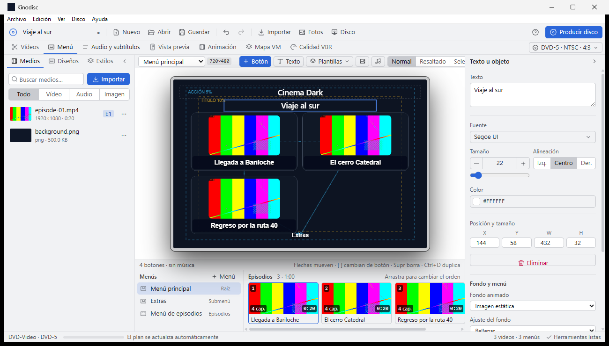
</p>

<p align="center">
  
</p>

<h1 align="center">Kinodisc</h1>

<p align="center">
  Convierte tus vídeos en un DVD, AVCHD o Blu-ray con menús de verdad, como los de las películas.<br />
  Importa, diseña el menú, pruébalo con un mando virtual y grábalo.
</p>

<p align="center">
  <strong>Español</strong> · <a href="README.md">English</a>
</p>

<p align="center">
  <a href="LICENSE"></a>
  
  
  
</p>

---

Kinodisc (antes *DVD Forge*) es un estudio de escritorio gratuito para crear
discos que se reproducen en el reproductor del living: menús con miniaturas,
capítulos, varias pistas de audio y subtítulos, «reproducir todo», menús de
escenas… el disco completo, revisado antes de grabarlo.

## Novedades de la 1.1

- **Arreglar el vídeo**: girar y espejar vídeos del celular, recortar bordes
  negros (los detecta solo), brillo/contraste/saturación, quitar ruido,
  desentrelazar y un **fondo desenfocado** detrás de los vídeos verticales,
  con vista previa encuadrada como en el disco.
- **Unir vídeos** en un episodio (partes de una filmación, los clips del
  celular de un día), con un capítulo al principio de cada uno.
- **Capítulos en los cambios de escena**, automáticos.
- **Probar la calidad** antes de producir: 10 segundos codificados igual que en
  el disco, al lado del original, con un veredicto claro.
- **15 plantillas de menú** (boda, cumpleaños, viaje, deportes, vacaciones,
  cine antiguo, naturaleza, documental, infantil, elegante…), cada una con sus
  colores y su decoración.
- **Carátula y etiqueta del disco** para imprimir a tamaño real (PNG a 300 ppp
  o imprimir).
- **Aviso al terminar** (sonido y barra de tareas) y opción de **apagar al
  terminar**.
- **Volver a vincular vídeos movidos**: los archivos que faltan se marcan y se
  encuentran en su nueva carpeta.
- **DVD unas 5 veces más rápido** con la misma calidad, y arreglos encontrados
  en una prueba completa (vídeos entrelazados con FFmpeg 9, proyectos nuevos,
  menús de la CLI…).
- **FreeBSD**: herramienta de línea de comandos precompilada en cada versión.

## Novedades de la 1.0

- **Interfaz nueva.** Tema claro y oscuro que sigue al sistema, barra de menú
  nativa, barra de herramientas, barra de estado y paneles compactos.
- **Primeros pasos más fáciles.** En Windows, Kinodisc descarga y verifica
  FFmpeg y DVDAuthor por vos; un proyecto vacío te dice qué hacer primero.
- **Deshacer/rehacer, autoguardado y recuperación**; arrastrar y soltar
  archivos y proyectos.
- **Textos de verdad en los menús.** Los títulos y textos se dibujan y se
  graban (antes desaparecían); selector de fuentes con vista previa, paleta de
  colores y tamaños.
- **Guías inteligentes, alinear y menú contextual** en el editor de menús.
- **Varios discos de una vez**: reparte un proyecto largo en varios discos o
  crea uno por episodio; o genera una **carpeta** VIDEO_TS/BDMV en vez de ISO.
- **Menús de escenas** creados a partir de los capítulos.
- **Presentaciones de fotos** con fundidos y música, como un episodio más.
- **Inspector de discos**: mira qué hay en un ISO o carpeta VIDEO_TS/BDMV e
  importa un disco sin cifrar como episodios.
- **En Blu-ray cada episodio vuelve al menú** al terminar, y las marcas de
  capítulo ahora son correctas sin tsMuxeR.
- **DVD más rápidos**: los episodios se codifican en paralelo (cerca de un
  40 % menos de tiempo en un PC de varios núcleos).
- **Protegido** para que ningún malware lo use de trampolín (ver
  [docs/security/2026-11-review.md](docs/security/2026-11-review.md)).

Lista completa: [CHANGELOG.md](CHANGELOG.md).

## Capturas

| | |
|---|---|
| 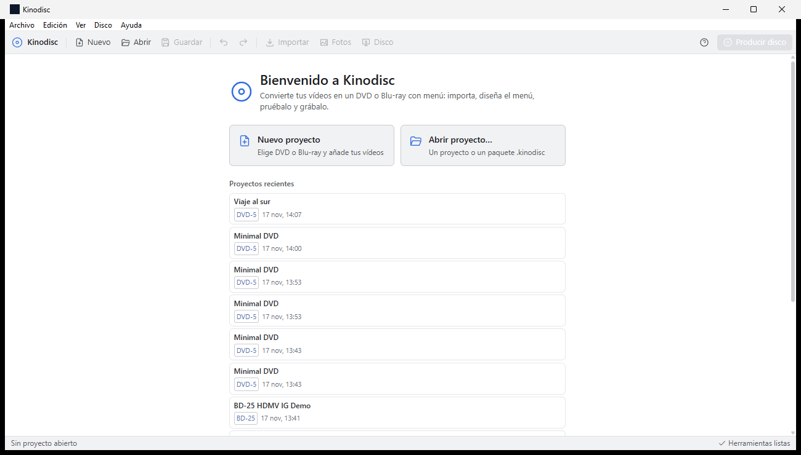 | 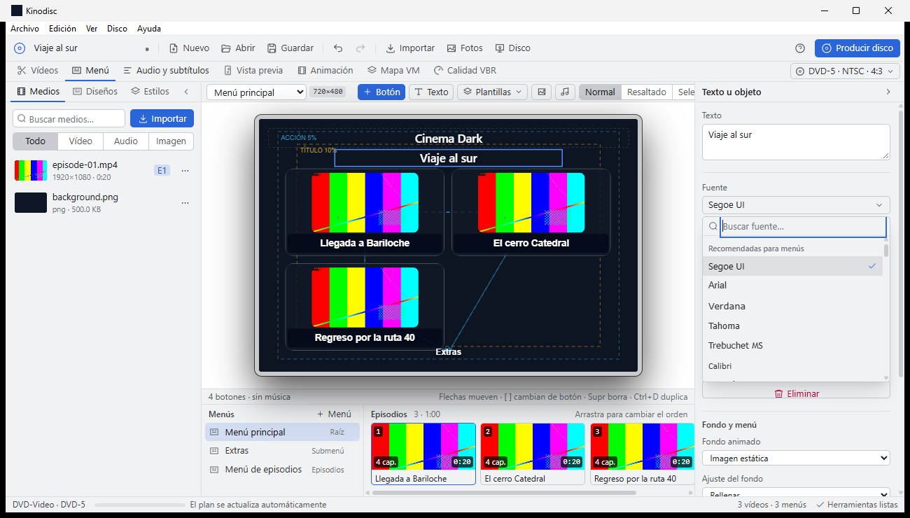 |
| Pantalla de bienvenida, sigue el tema del sistema | Textos del menú con selector de fuentes |
| 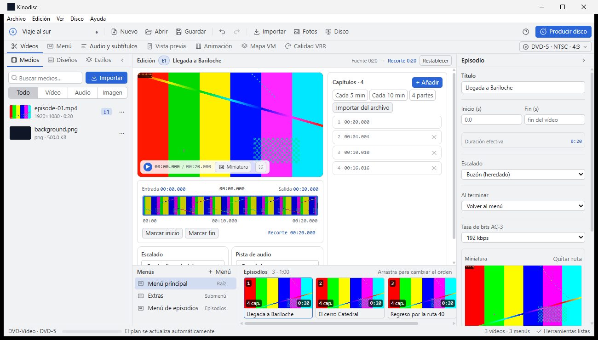 | 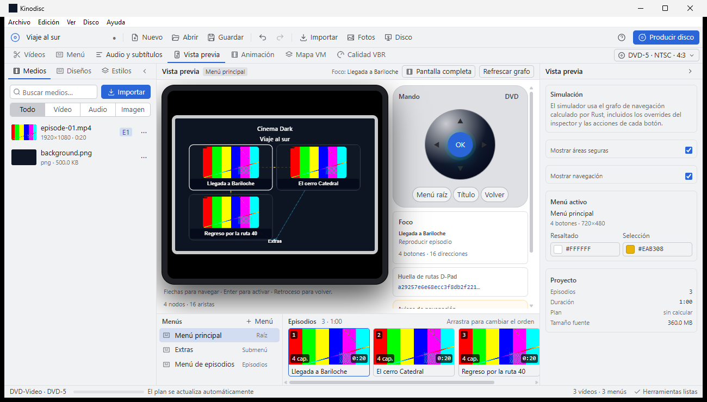 |
| Recorte y capítulos sobre una tira de fotogramas | Prueba el disco con un mando virtual |
| 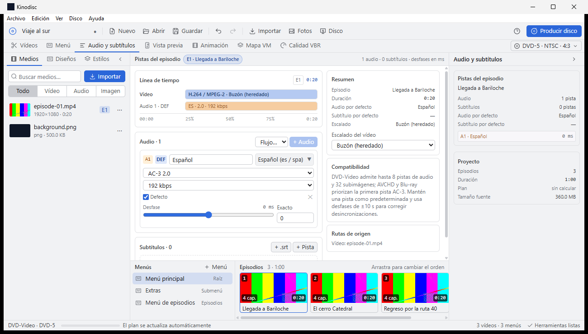 | 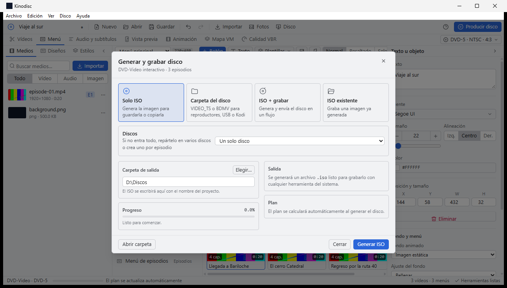 |
| Idiomas de audio, subtítulos y desfases | ISO, carpeta del disco, varios discos, grabación |
| 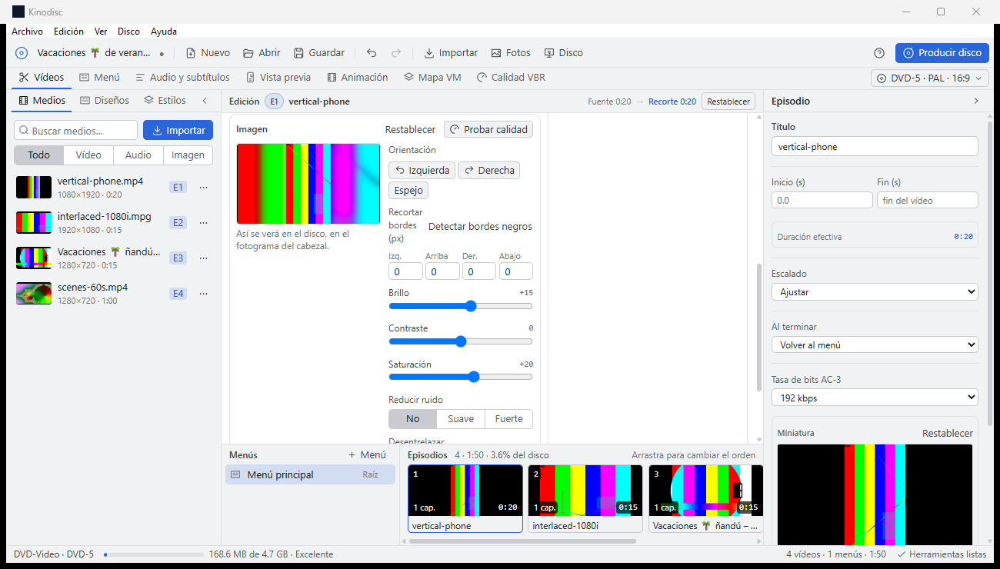 | 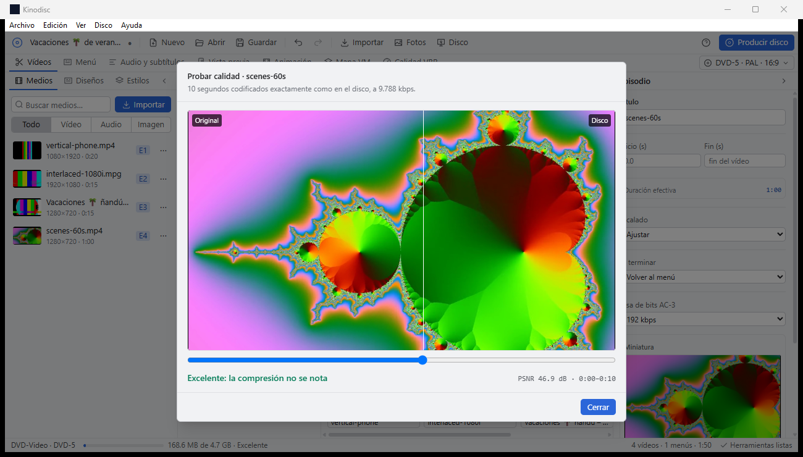 |
| Girar, recortar, color, laterales desenfocados | 10 s codificados como en el disco, lado a lado |
| 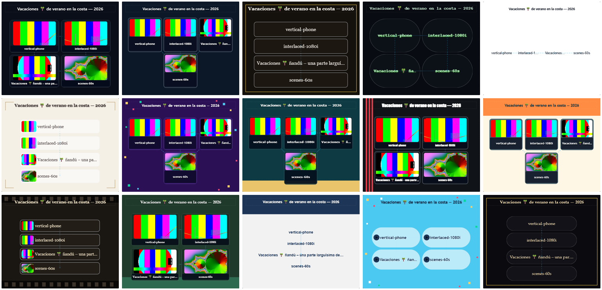 | 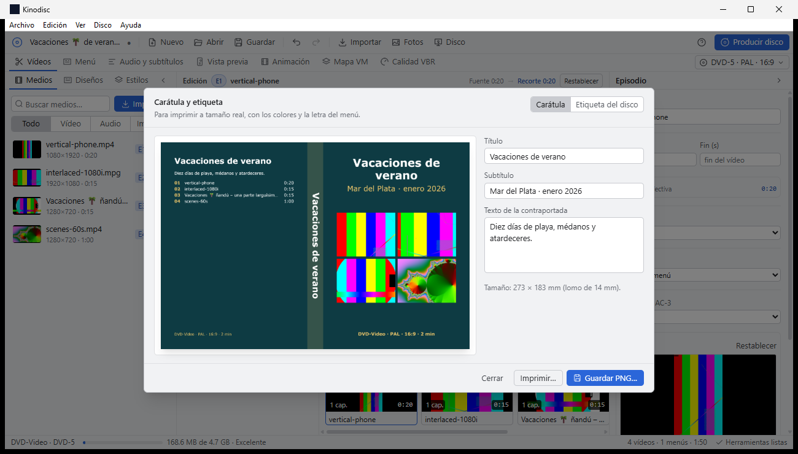 |
| 15 plantillas de menú | Carátula y etiqueta para imprimir |

<p align="center">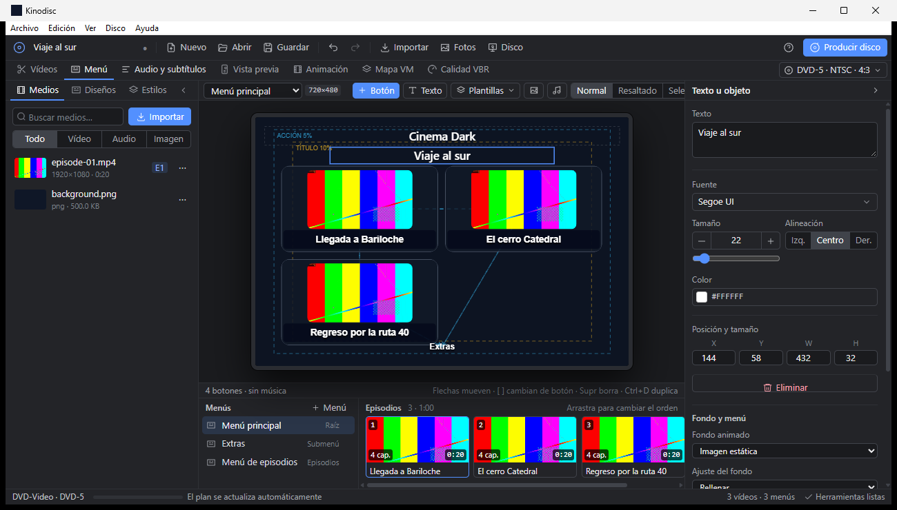</p>

## Qué discos crea

| Disco | Vídeo | Menús |
|---|---|---|
| **DVD-Video** (DVD-5, DVD-9 con cambio de capa) | MPEG-2 en dos pasadas, PAL/NTSC, 4:3/16:9 | Estáticos y animados, resaltado por subimagen |
| **AVCHD** en DVD | H.264 720p/1080i/1080p, AVCHD 2.0 50/60p | HDMV Interactive Graphics |
| **Blu-ray** (BD-25, BD-50) | H.264, copia directa de archivos compatibles | HDMV Interactive Graphics |

Además: hasta 8 pistas de audio (AC-3) y 32 de subtítulos por título DVD,
subtítulos SRT/ASS/VTT renderizados de forma nativa, PGS directo en Blu-ray,
códigos de región, ajustes por reproductor (PS2, PS3/4/5, DVD antiguos),
«reproducir todo», menús de escenas, intro, un verificador estructural que
revisa cada imagen antes de grabar, y grabación nativa en Windows (IMAPI2),
Linux/FreeBSD (growisofs/xorriso) y macOS.

## Instalación

Descarga el instalador para tu sistema en la
[página de versiones](https://github.com/Nicolasalucin/kinodisc/releases):

| Sistema | Archivos |
|---|---|
| Windows 10/11 (64 o 32 bits) | `.msi` o `-setup.exe`; CLI portátil |
| Linux x86_64 | `.AppImage`, `.deb`, CLI comprimida |
| Linux i686 | CLI comprimida |
| macOS (Apple Silicon / Intel) | `.dmg`, CLI comprimida |
| FreeBSD x86_64 | CLI comprimida; la app de escritorio, desde el código |

Cada versión incluye `SHA256SUMS.txt` para comprobar las descargas.

### Herramientas de vídeo

- **Windows:** no hay que instalar nada. Al empezar, Kinodisc ofrece descargar
  FFmpeg y DVDAuthor (unos 120 MB), comprueba su SHA-256 y los guarda en tu
  carpeta de usuario. Opcional: tsMuxeR.
- **Linux:**
  ```bash
  # Debian / Ubuntu
  sudo apt install ffmpeg dvdauthor dvd+rw-tools xorriso
  # Fedora
  sudo dnf install ffmpeg dvdauthor dvd+rw-tools xorriso
  # Arch
  sudo pacman -S --needed ffmpeg dvdauthor dvd+rw-tools libisoburn
  ```
- **macOS:** `brew install ffmpeg dvdauthor`
- **FreeBSD:** `pkg install ffmpeg dvdauthor dvd+rw-tools xorriso`

En la barra de estado, *Herramientas* muestra qué está instalado y qué falta.

## Primeros pasos

1. **Nuevo proyecto** → elige DVD o Blu-ray/AVCHD.
2. **Importar vídeos** (o arrástralos a la ventana): cada uno es un episodio.
3. Recorta y añade capítulos en **Vídeos**; elige idiomas en **Audio y subtítulos**.
4. En **Menú**, elige una plantilla, añade un título y ajusta botones y fuentes.
5. Pruébalo en **Vista previa** con el mando virtual.
6. **Producir disco**: ISO, carpeta VIDEO_TS/BDMV, varios discos o grabar directo.

Guías paso a paso: [Español](docs/GUIA-DE-USO.md) · [English](docs/USER_GUIDE.md).

## Línea de comandos

`kinodisc-cli` usa el mismo motor que la app, para scripts y trabajo por lotes:

```bash
kinodisc-cli doctor                                  # herramientas y versiones
kinodisc-cli toolchain install all                   # descargas verificadas (Windows)
kinodisc-cli render proyecto.json -o salida --folder # ISO + carpeta VIDEO_TS/BDMV
kinodisc-cli split proyecto.json --per-episode       # un proyecto por disco
kinodisc-cli scenes proyecto.json                    # menús de escenas desde los capítulos
kinodisc-cli chapters proyecto.json --scenes         # capítulos en los cambios de escena
kinodisc-cli join parte1.mp4 parte2.mp4 -o unido.mp4 # varios clips en un vídeo
kinodisc-cli slideshow fotos/*.jpg --music tema.mp3 -o salida
kinodisc-cli inspect disco.iso --import importado/   # qué hay en un disco
kinodisc-cli batch cola.json --resume                # muchos discos seguidos
kinodisc-cli verify salida/disc.iso --deep           # comprobación estructural
kinodisc-cli burn salida/disc.iso --device /dev/sr0
```

## Compilar desde el código

```bash
cd apps/desktop && npm ci && npm run tauri build     # aplicación de escritorio
cargo build --release -p kinodisc-cli                # CLI
```

Hace falta Rust (estable) y Node.js 22. Notas técnicas para quienes
contribuyen y para agentes de IA: [AGENTS.md](AGENTS.md).

## Privacidad y seguridad

Kinodisc funciona sin conexión. Solo se conecta a internet para descargar las
herramientas de vídeo cuando se lo pides (archivos fijos con su suma de
verificación) y, como mucho una vez al día, para preguntarle a GitHub si hay
una versión nueva: no envía nada sobre ti y se desactiva en Ayuda. Nunca ejecuta programas de la carpeta actual, rechaza
herramientas modificadas después de descargarlas y solo abre los archivos que
eliges.

## Agradecimientos

Gracias a estas personas de la comunidad por encontrar errores y proponer
mejoras: **OhItsStefan**, **Infinite_Silver483**, **Narrow-Chard4152**,
**Mirandopacuenca67** y **Carllito7**.

## Licencia

GPL-3.0-or-later. Ver [LICENSE](LICENSE). FFmpeg, DVDAuthor y tsMuxeR son
programas aparte con sus propias licencias.
