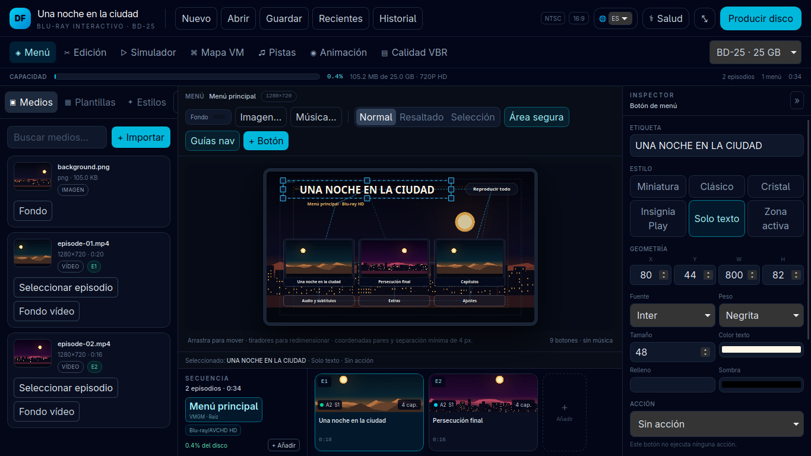
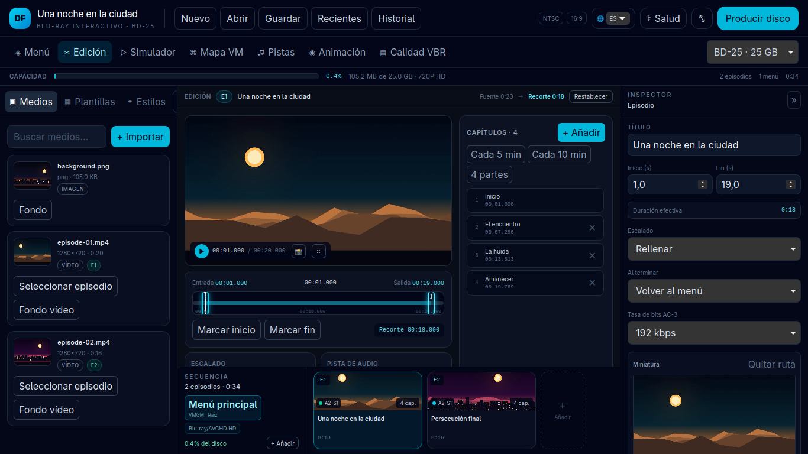
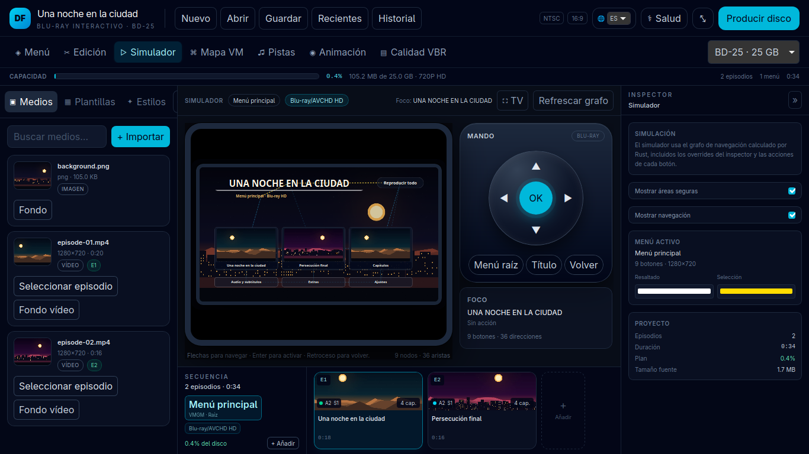
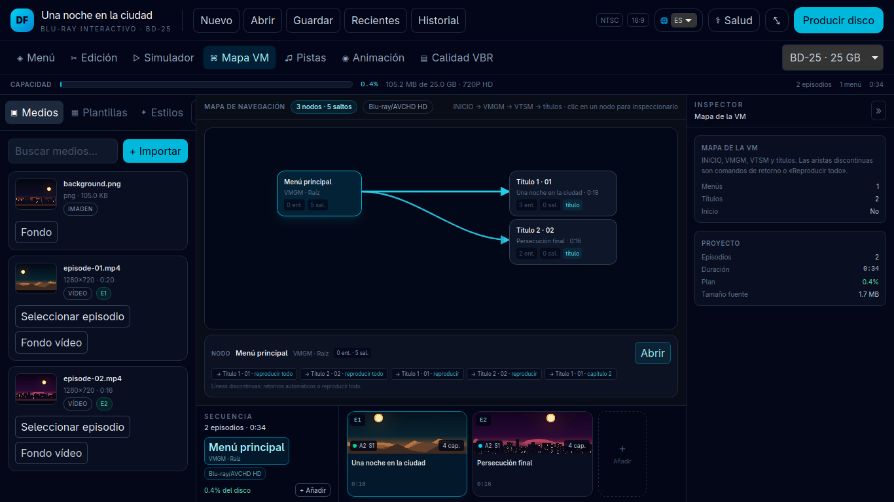
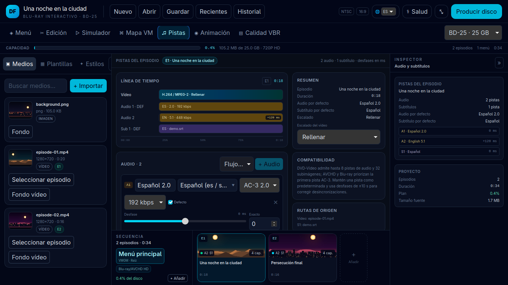
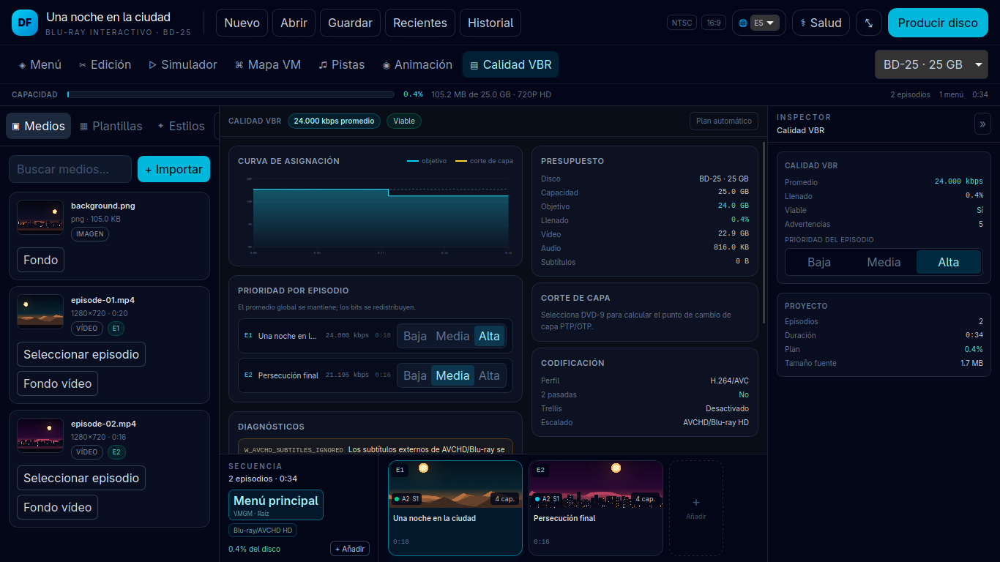

<p align="center">
  
</p>

<h1 align="center">DVD Forge</h1>

<p align="center">
  Estudio de autoría óptica para DVD-Video, AVCHD y Blu-ray, con menús interactivos,
  edición no destructiva, simulación de navegación y grabación nativa.
</p>

<p align="center">
  <a href="README.md">🇺🇳 English</a> · <strong>🇪🇸 Español</strong>
</p>

<p align="center">
  <a href="LICENSE"></a>
  
  
  
  
</p>

---

## Un solo taller para todo el disco

DVD Forge reúne en una única ventana la biblioteca de medios, el editor visual de
menús, el recortador, los capítulos, las pistas de audio y subtítulos, la
simulación del mando a distancia, el mapa de navegación y la producción final.
El mismo proyecto puede entregarse como DVD-Video clásico o como AVCHD/Blu-ray
de alta definición, sin duplicar el trabajo creativo.

## Galería

| Menú WYSIWYG | Recortador y capítulos |
|---|---|
|  |  |

| Simulador con mando | Mapa de la máquina virtual |
|---|---|
|  |  |

| Audio y subtítulos | Optimizador VBR |
|---|---|
|  |  |

## Novedades de v0.4.0

### Memoria y streaming en 32 bits

- Todas las rutas de varios gigabytes usan buffers de streaming acotados
  (64 KiB–1 MiB): huellas de origen, hashes de subtítulos/menús, payloads UDF,
  verificación de grabación y procesado de M2TS de menús.
- El escritor UDF comparte rutas con `Arc<str>`, pre-reserva nodos y extensiones
  y mantiene un buffer de payload/digest de 1 MiB. Las pruebas de imágenes
  dispersas de >4 GiB y 50 GiB usan una fuente posicional de fichero.
- Las compilaciones Windows de 32 bits solicitan `/LARGEADDRESSAWARE` y la pila
  completa se comprueba en `i686-unknown-linux-gnu`.

### Toolchain portable y sin dependencia de 32 bits

- Se buscan `DVDFORGE_TOOLCHAIN_DIR` y carpetas junto al ejecutable
  (`toolchain/`, `toolchain/<plataforma>-<arch>/`, `bin/`) antes de los
  recursos empaquetados y del PATH.
- tsMuxeR pasa a ser opcional: un muxer nativo Rust + FFmpeg construye el M2TS
  principal, `index.bdmv`, `MovieObject.bdmv`, MPLS, CLPI, marcas de capítulo y
  menús HDMV IG cuando tsMuxeR no está o el host es de 32 bits.

### Paso directo de PGS

- Las pistas `hdmv_pgs_subtitle` activas se copian al M2TS AVCHD/Blu-ray y se
  registran en MPLS STN y CLPI.
- DVD-Video conserva `W_BITMAP_SUBTITLE_UNSUPPORTED`; los códecs bitmap que no
  son PGS siguen rechazándose en Blu-ray.

### FreeBSD y releases multiarquitectura

- CLI y grabación nativos en FreeBSD con `camcontrol`, `dvd+rw-mediainfo`,
  `growisofs` y `xorriso`.
- Releases Windows x86_64/i686 (WebView2 x86), Linux x86_64/i686 y macOS
  Apple Silicon/Intel. Los binarios usan LTO thin, una codegen-unit y símbolos
  eliminados.

## Características principales

### Estudio unificado

- Workbench de ventana única con biblioteca de medios, lienzo Konva, inspector,
  secuencia de episodios y barra de capacidad siempre visible.
- Proyectos portables en JSON con validación estructural, presupuesto de disco y
  diagnóstico de errores antes de codificar.
- Autoguardado de proyectos recientes e historial de trabajos en SQLite.
- Diagnóstico de toolchain integrado para comprobar FFmpeg, tsMuxeR, DVDAuthor,
  xorriso, growisofs, `dvd+rw-mediainfo` y libbluray.

### DVD-Video clásico

- Autoría DVD-5 y DVD-9 con cálculo de **Layer Break OTP/PTP** alineado a bloques
  ECC de 16 sectores.
- Compatibilidad con reproductores de salón, PlayStation 2/3/4/5, Xbox y
  reproductores de software.
- Menús VMGM/VTSM, First Play, capítulos, Reproducir todo y retorno automático.
- Máscara de región DVD real en `VIDEO_TS.IFO` y `VIDEO_TS.BUP`, además de la
  comprobación RCE.
- MPEG-2 en dos pasadas, AC-3 2.0/5.1 y subtítulos `.srt`/`.ass`/`.ssa`/`.vtt`
  con ajuste de sincronía. En HD, las pistas se conservan en el proyecto y se
  muestran en el editor.
- Ajuste MPEG-2 de referencia (Lanczos, RD, Trellis, DC dinámico y GOP estricto
  PAL/NTSC).
- El DVD-9 marca la celda del layer break en el VTS IFO y el verificador
  comprueba su alineación ECC y su posición en el PGC.

### Alta definición

- **AVCHD sobre DVD-5/DVD-9** y **Blu-ray nativo BD-25/BD-50**.
- H.264 High con `bluray-compat`, GOP cerrado, VBV de 30.000–40.000 kbits y
  hasta 38 Mbps en Blu-ray.
- Menús **HDMV Interactive Graphics** nativos: PDS, WDS, ODS con RLE, ICS y END,
  botones con estados normal/seleccionado/activado y navegación direccional.
- Menús anidados: cada menú se publica como su propio clip IG/Playlist y se
  enlaza con `JumpObject`; los botones de episodio y capítulo arrancan en la
  marca exacta mediante GPR y `PlayPL_PM`.
- Codificación H.264 por hardware opcional (NVENC, QSV, VAAPI, AMF,
  VideoToolbox) con fallback automático a CPU.
- Caché inteligente de episodios, menús e intros, indexada por SHA-256 completo
  y entradas de render canónicas.
- Fondos de vídeo en bucle, botones con miniatura en movimiento y audio de menú
  AC-3 con volumen, fundidos y pista silenciosa de respaldo.
- Imagen final **UDF 2.50 con Metadata Partition** (Metadata File + Metadata
  Mirror File), legible por libbluray, reproductores de salón y consolas.

### Editor visual

- Lienzo WYSIWYG con coordenadas pares, rejilla, áreas seguras y guías de acción.
- Seis estilos de botón: miniatura 16:9, clásico, cristal, insignia Play, solo
  texto y **hotspot invisible** sobre arte propio.
- Navegación automática por geometría con overrides manuales por dirección.
- Miniaturas y fotogramas extraídos del vídeo original.
- Previsualización de menús estáticos y animados antes de producir el disco.

### Medios y accesibilidad

- Importación directa de `.mp4`, `.mkv`, `.avi`, `.mov` y otros contenedores
  habituales. El editor crea un proxy MP4 en caché para la previsualización,
  pero conserva siempre el archivo original como fuente de máxima calidad.
- Recorte no destructivo **In/Out** y gestión de capítulos por tiempo o fotograma.
- Varias pistas de audio AC-3 2.0/5.1, pista predeterminada, ganancia y delay.
- Subtítulos externos con idioma, etiqueta, pista forzada y desfase.
- Simulador interactivo con mando virtual, foco, activación y botones de menú.
- Mapa de nodos de la máquina virtual con las transiciones reales del proyecto.

### Internacionalización

- Motor i18n reactivo en Svelte 5, sin dependencias pesadas.
- Siete idiomas de interfaz: **español, inglés, portugués, francés, alemán,
  italiano y japonés**.
- Detección automática en el primer arranque desde `navigator.language`,
  persistencia en `localStorage` (`dvdforge_locale`) y cambio en vivo desde la
  cabecera.
- Catálogo oficial de idiomas ISO 639 para pistas de audio y subtítulos: códigos
  ISO 639-1 de 2 letras para DVD-Video e ISO 639-2/T de 3 letras para
  Blu-ray/AVCHD, con alias bibliográficos (`fre`, `ger`, `chi`, `baq`).
- Los valores `tags.language` de FFprobe se normalizan automáticamente al
  catálogo al importar medios.
- Documentación bilingüe: este README en español y [README.md](README.md) en
  inglés.

### Producción y grabación

- Pipeline compartido entre la aplicación y la CLI: los mismos menús, subtítulos,
  regiones y presupuestos se aplican en ambos entornos.
- Grabación óptica nativa en Linux (`growisofs` con fallback a `xorriso`),
  Windows (`IMAPI2`) y macOS (`drutil`/`hdiutil`).
- Soporte de DVD-R/RW, DVD+R/RW, BD-R, BD-RE y BD-R DL, con detección de perfil
  MMC, capacidad y velocidad real del medio.
- Verificación SHA-256 opcional y cancelación limpia de render o grabación.
- Caché SHA-256 de artefactos para evitar recodificar fuentes, recortes, audio o
  bitrates sin cambios.

## Arquitectura de formatos ópticos

| | DVD-Video | AVCHD | Blu-ray |
|---|---|---|---|
| Medio | DVD-5 / DVD-9 | DVD-5 / DVD-9 | BD-25 / BD-50 |
| Vídeo | MPEG-2, dos pasadas | H.264 High | H.264 High, hasta 38 Mbps |
| Audio | AC-3 2.0/5.1 | AC-3 2.0/5.1 | AC-3 2.0/5.1 |
| Menús | VMGM/VTSM, botones SPU | HDMV Interactive Graphics | HDMV Interactive Graphics |
| Navegación | Máquina virtual DVD | IG + Playlist + GPR | IG + Playlist + GPR |
| Sistema de archivos | UDF 1.02 / ISO 9660 | UDF 2.50 | UDF 2.50 + Metadata Partition |
| Layer break | OTP/PTP, ECC de 16 sectores | n/a | n/a |
| Objetivos típicos | Reproductores, PS2–PS5, Xbox | PS4/PS5, reproductores Blu-ray | Reproductores Blu-ray, PS4/PS5 |

## Catálogo de idiomas

| Idioma | ISO 639-1 (DVD) | ISO 639-2/T (Blu-ray/AVCHD) | Alias bibliográfico |
|---|---|---|---|
| Español | `es` | `spa` | — |
| Inglés | `en` | `eng` | — |
| Japonés | `ja` | `jpn` | — |
| Portugués | `pt` | `por` | — |
| Francés | `fr` | `fra` | `fre` |
| Alemán | `de` | `deu` | `ger` |
| Italiano | `it` | `ita` | — |
| Ruso | `ru` | `rus` | — |
| Chino | `zh` | `zho` | `chi` |
| Coreano | `ko` | `kor` | — |
| Catalán | `ca` | `cat` | — |
| Euskera | `eu` | `eus` | `baq` |
| Gallego | `gl` | `glg` | — |
| Árabe | `ar` | `ara` | — |
| Hindi | `hi` | `hin` | — |
| Indeterminado / Original | `und` | `und` | — |

## Plataformas

| Plataforma | Arquitectura | Distribución |
|---|---|---|
| Linux | x86_64 | AppImage, `.deb`, CLI tar.gz |
| Linux | i686 | CLI tar.gz y pruebas en 32 bits |
| Windows | x86_64 | MSI, NSIS, CLI portátil |
| Windows | i686 | MSI/NSIS 32-bit con WebView2 x86, CLI zip |
| macOS | Apple Silicon / Intel | `.dmg`, CLI tar.gz |
| FreeBSD | x86_64 | Compilación desde código, CLI y grabación nativa |

> En Linux i686 el CLI y toda la pila de authoring están soportados de forma
> nativa. El escritorio Linux de 32 bits no se publica porque WebKitGTK/GTK de
> 32 bits no está disponible en todas las distribuciones.

## Requisitos

### Linux

Herramientas del sistema:

```bash
# Arch / CachyOS
sudo pacman -S --needed ffmpeg dvdauthor dvd+rw-tools libisoburn udftools \
  gstreamer gst-plugins-base gst-plugins-good gst-libav

# Debian / Ubuntu
sudo apt install ffmpeg dvdauthor dvd+rw-tools xorriso udftools \
  gstreamer1.0-plugins-base gstreamer1.0-plugins-good gstreamer1.0-libav \
  libwebkit2gtk-4.1-0 libgtk-3-0

# Fedora
sudo dnf install ffmpeg dvdauthor dvd+rw-tools xorriso udftools \
  gstreamer1-plugins-base gstreamer1-plugins-good gstreamer1-plugins-bad-free \
  webkit2gtk4.1 gtk3
```

`tsMuxeR` es opcional en hosts de 64 bits: AVCHD/Blu-ray puede autorarse con la
ruta nativa de FFmpeg. Coloca las herramientas en `toolchain/` junto al binario,
define `DVDFORGE_TOOLCHAIN_DIR` o usa el `PATH`. `libbluray`/`bd_info` son
opcionales.

### Windows

- Windows 10 de 64 o 32 bits y Windows 11 de 64 bits, con WebView2.
- FFmpeg/FFprobe y DVDAuthor/Spumux en el `PATH`; tsMuxeR es opcional.
- La grabación usa la API nativa IMAPI2; no requiere herramientas externas.

### macOS

Ejecuta el `.dmg` de releases o compila desde el código. La grabación utiliza
`drutil`/`hdiutil`; FFmpeg es obligatorio y tsMuxeR opcional.

### FreeBSD

```bash
pkg install ffmpeg dvdauthor dvd+rw-tools xorriso
```

La grabación usa `camcontrol`, `growisofs` y `xorriso`; tsMuxeR es opcional.

## Instalación

### Paquetes

Descarga el instalador correspondiente desde la página de releases:

- Linux x86_64: `.AppImage`, `.deb` y CLI tar.gz.
- Linux i686: `dvdforge-cli-i686-unknown-linux.tar.gz`.
- Windows x86_64/i686: `.msi`, instalador NSIS y CLI portátil.
- Windows i686 CLI: `dvdforge-cli-i686-pc-windows-msvc.zip`.
- macOS Apple Silicon/Intel: `.dmg` y CLI tar.gz.
- CLI universal: `dvdforge-cli` para automatizar planes, renders y grabación.

### Compilar desde el código

```bash
# Dependencias del frontend
cd apps/desktop
npm ci

# Aplicación de escritorio
npm run tauri build

# CLI
cd ../..
cargo build --release -p dvdforge-cli
```

Para compilar la CLI de 32 bits:

```bash
rustup target add i686-unknown-linux-gnu
cargo build --release -p dvdforge-cli --target i686-unknown-linux-gnu
```

## Uso rápido

1. Crea un proyecto DVD-Video, AVCHD o Blu-ray.
2. Importa los vídeos y arrástralos a la secuencia.
3. Recorta In/Out, añade capítulos y ajusta audio/subtítulos.
4. Diseña el menú, asigna acciones y comprueba la navegación en el simulador.
5. Abre **Producir disco**, elige ISO o ISO + grabación y selecciona la unidad.
6. Verifica el resultado con el reproductor o graba el disco final.

## CLI

```bash
# Comprobar herramientas del sistema
dvdforge-cli doctor

# Inspeccionar un archivo
dvdforge-cli probe pelicula.mkv --json

# Calcular el presupuesto de un proyecto
dvdforge-cli plan proyecto.json -o plan.json --probe

# Generar el ISO con el mismo pipeline que la aplicación
dvdforge-cli render proyecto.json -o salida

# Verificación estructural (UDF/BDMV/DVD) antes de grabar
dvdforge-cli verify salida/disc.iso --deep --strict

# Listar unidades y grabar
dvdforge-cli devices
dvdforge-cli burn salida/disc.iso --device /dev/sr0 --speed 4
```

La CLI comparte el renderizador, los menús HDMV, los subtítulos de DVD, las
regiones, el presupuesto BD-25/BD-50 y la caché de artefactos con la aplicación
de escritorio.

## Tecnología

- **Rust** para el dominio, planificación, codificación, authoring, ISO/UDF,
  menús HDMV, persistencia SQLite y grabación óptica.
- **Tauri v2** como puente nativo seguro entre la interfaz y el sistema.
- **Svelte 5 + Vite + Tailwind CSS 4 + Konva** para el editor visual.
- **FFmpeg**, **tsMuxeR**, **DVDAuthor/Spumux**, **xorriso**, **growisofs** y
  **libbluray** como motores externos.

## Hoja de ruta

El plan de ingeniería v0.5.0–v1.0.0 cubre renderizado nativo de subtítulos y
masterización de audio, el diseñador de menús 2.0, copia directa de streams,
checkpointing, fuzzing, empaquetado y el congelamiento del esquema LTS v1.0.0.
Consulta [ROADMAP.md](ROADMAP.md) para crates objetivo, entregables, IDs de
verificación y criterios de aceptación.

## Licencia

DVD Forge se distribuye bajo **GNU General Public License v3.0 or later**
(`GPL-3.0-or-later`). Consulta [LICENSE](LICENSE) para el texto completo.
