<p align="center">
  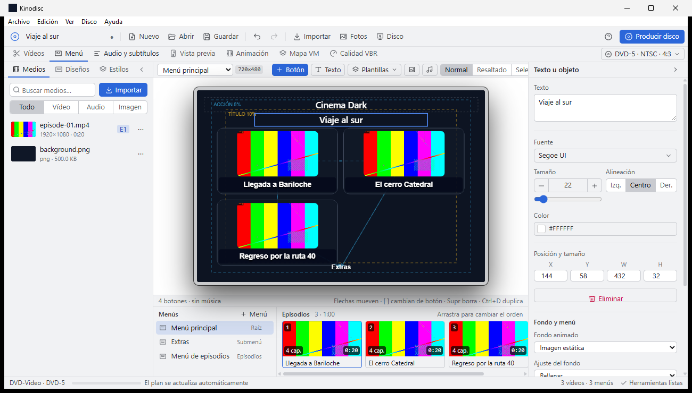
</p>

<p align="center">
  
</p>

<h1 align="center">Kinodisc</h1>

<p align="center">
  Turn your videos into a DVD, AVCHD or Blu-ray disc with real menus, like the ones on movies.<br />
  Import, design the menu, try it with a virtual remote, burn.
</p>

<p align="center">
  <a href="README.es.md">Español</a> · <strong>English</strong>
</p>

<p align="center">
  <a href="LICENSE"></a>
  
  
  
</p>

---

Kinodisc (formerly *DVD Forge*) is a free desktop studio for making optical
discs that play on a living-room player: menus with thumbnails, chapters,
several audio and subtitle tracks, play all, scene selection — the whole disc,
checked before it is burned.

## What's new in 1.2

- **Auto-play**: a toggle on the DVD main menu starts playing everything when
  nobody chooses anything by the time the menu ends.
- **Even volume across the disc**: one checkbox in Audio and subtitles levels
  the volume of every episode.
- **Data disc**: **Disc › Data disc…** burns any folder (photos, documents,
  the original files) to a CD, DVD or Blu-ray that opens on a computer, and
  tells you which disc the folder fits.
- **Several copies in a row**: choose how many copies to burn; after each one
  the app asks for the next blank disc.
- **Audio and subtitles menu on the disc**: a generated Settings page lets the
  viewer pick the audio language and the subtitles with the remote.
- **Disc label** field in the disc settings.
- **A long list of fixes** found by independent QA passes over the whole app
  (see the [changelog](CHANGELOG.md)).

## What's new in 1.1

- **Fix the video**: rotate and mirror phone videos, crop black borders
  (detected for you), brightness/contrast/saturation, noise reduction,
  deinterlacing, and a **blurred background** behind vertical videos — with a
  live preview framed like the disc.
- **Join videos** into one episode (camcorder parts, a day of phone clips),
  with a chapter at the start of each.
- **Chapters at scene changes**, found automatically.
- **Test the quality** before producing: 10 seconds encoded exactly as on the
  disc, side by side with the original, with a plain verdict.
- **15 menu templates** (wedding, birthday, travel, sports, holidays, old film,
  nature, documentary, kids, elegant…), each with its own colours and
  decoration.
- **Case cover and disc label** to print at real size (300 dpi PNG or print).
- **Notice when done** (sound and taskbar), optional **shut down when done**.
- **Relink moved videos**: missing files are marked and found again in their
  new folder.
- **About 5× faster DVD encoding** with the same quality, plus bug fixes found
  by a full walkthrough (interlaced videos with FFmpeg 9, new projects, CLI
  menus…).
- **FreeBSD**: prebuilt command-line tool in every release.

## What's new in 1.0

- **A new interface.** Light and dark themes that follow your system, a native
  menu bar, a toolbar, a status bar and compact, consistent panels.
- **Easier first steps.** Kinodisc downloads and verifies FFmpeg and DVDAuthor
  for you on Windows; an empty project tells you what to do first.
- **Undo/redo, autosave and recovery**, drag-and-drop of files and projects.
- **Real text on menus.** Titles and text objects are drawn and burned (they
  used to vanish); a font picker with live previews, colour palette and sizes.
- **Smart guides, alignment and a right-click menu** in the menu editor.
- **Several discs at once**: split a long project across discs or make one
  disc per episode; or write a VIDEO_TS/BDMV **folder** instead of an ISO.
- **Scene menus** generated from your chapters.
- **Photo slideshows** with cross-fades and music, added as an episode.
- **Disc inspector**: see what is on an ISO or VIDEO_TS/BDMV folder and import
  an unencrypted disc back as episodes.
- **Blu-ray episodes return to the menu** when they end (per-episode
  playlists) and chapter marks are now correct without tsMuxeR.
- **Faster DVDs**: episodes are encoded in parallel (about 40 % faster on a
  typical multi-core PC).
- **Hardened** against being used as a springboard by malware (see
  [docs/security/2026-11-review.md](docs/security/2026-11-review.md)).

Full list: [CHANGELOG.md](CHANGELOG.md).

## Screenshots

| | |
|---|---|
| 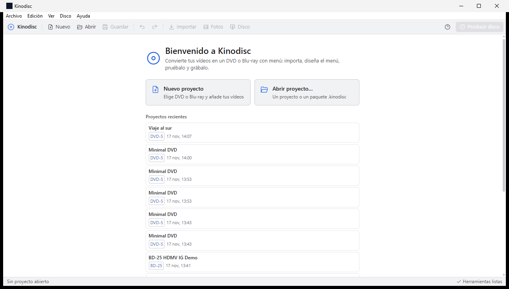 | 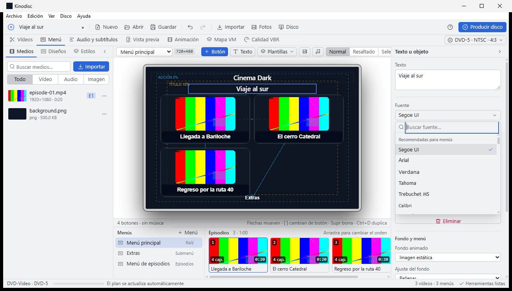 |
| Welcome screen, follows the system theme | Text on menus with a real font picker |
| 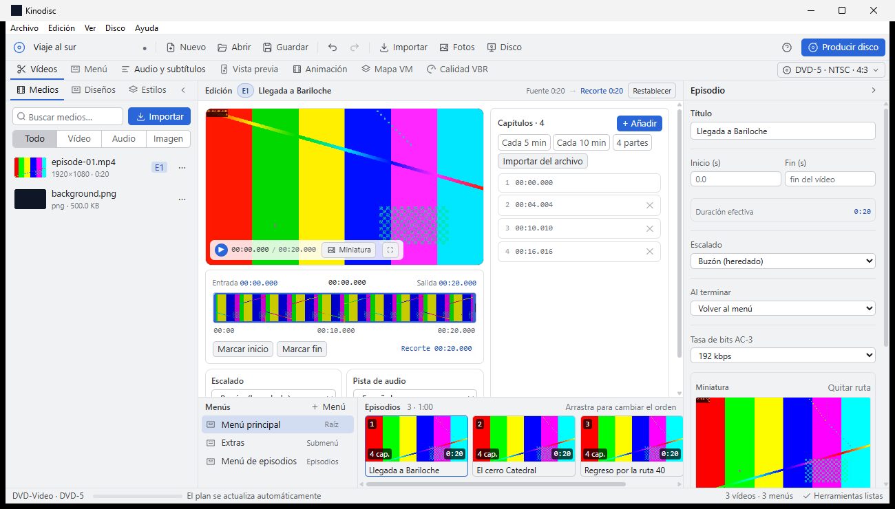 | 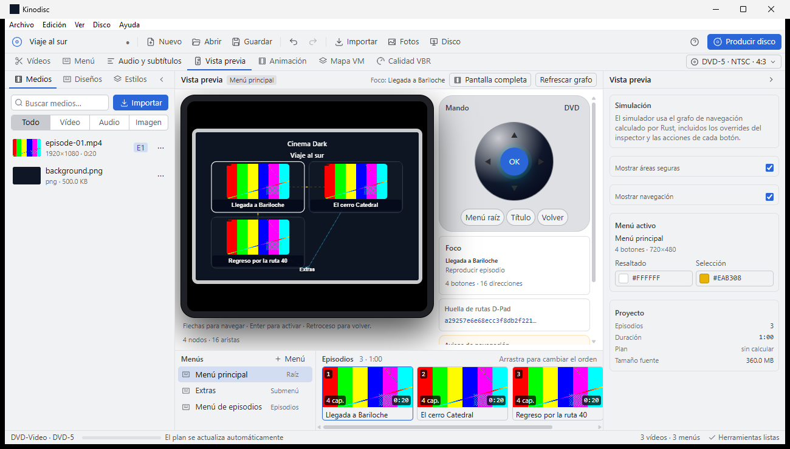 |
| Trim and chapters on a filmstrip | Try the disc with a virtual remote |
| 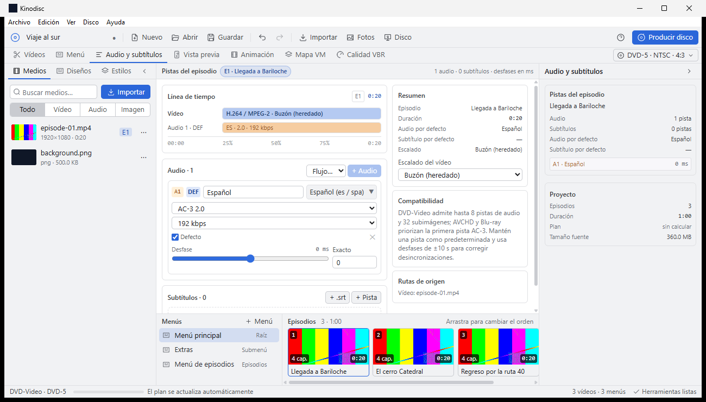 | 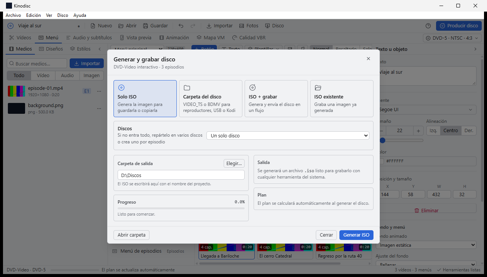 |
| Audio languages, subtitles and offsets | ISO, disc folder, several discs, burning |
| 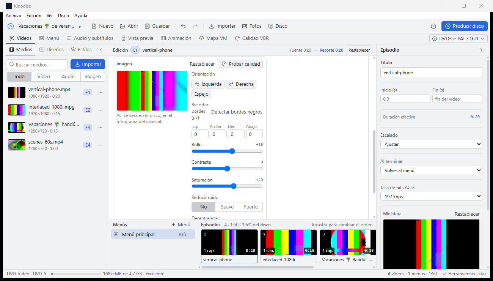 | 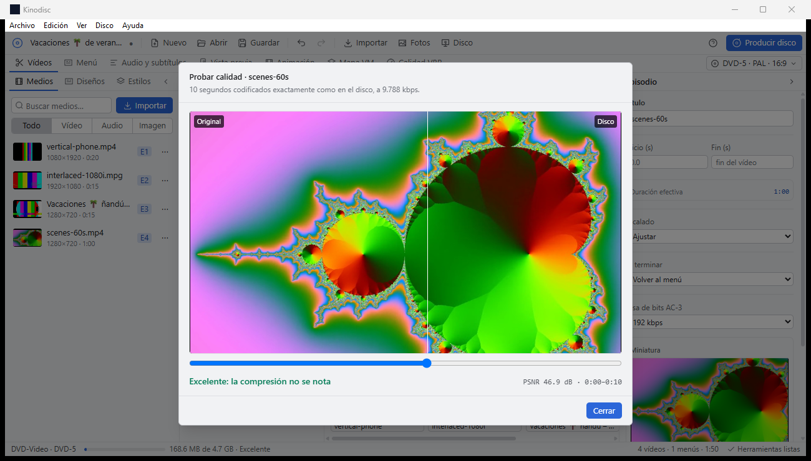 |
| Rotate, crop, colour, blurred sides for vertical videos | 10 s encoded as on the disc, side by side |
| 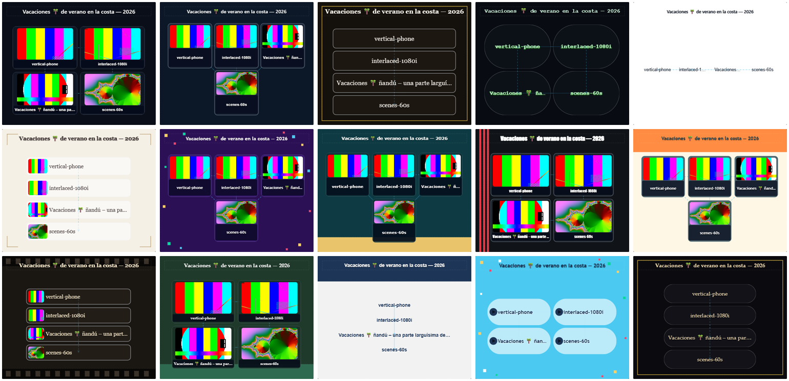 | 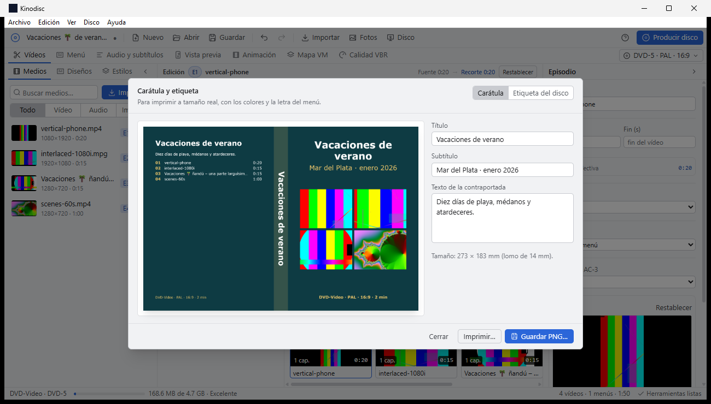 |
| 15 menu templates | Case cover and disc label to print |

<p align="center">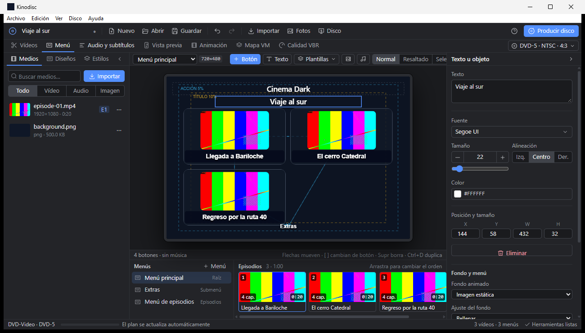</p>

## What it makes

| Disc | Video | Menus |
|---|---|---|
| **DVD-Video** (DVD-5, DVD-9 with layer break) | MPEG-2, two-pass, PAL/NTSC, 4:3/16:9 | Static and animated, subpicture highlights |
| **AVCHD** on DVD media | H.264 720p/1080i/1080p, AVCHD 2.0 50/60p | HDMV Interactive Graphics |
| **Blu-ray** (BD-25, BD-50) | H.264, smart stream copy of compatible files | HDMV Interactive Graphics |

Also: up to 8 audio tracks (AC-3) and 32 subtitle tracks per DVD title, SRT/ASS/VTT
subtitles rendered natively, PGS pass-through on Blu-ray, region codes, player
presets (PS2, PS3/4/5, old DVD players), Play All, scene menus, intro clips,
a structural verifier that checks every image before burning, and native
burning on Windows (IMAPI2), Linux/FreeBSD (growisofs/xorriso) and macOS.

## Install

Download the installer for your system from the
[releases page](https://github.com/Nicolasalucin/kinodisc/releases):

| System | Files |
|---|---|
| Windows 10/11 (64- or 32-bit) | `.msi` or `-setup.exe`; portable CLI |
| Linux x86_64 | `.AppImage`, `.deb`, CLI tarball |
| Linux i686 | CLI tarball |
| macOS (Apple Silicon / Intel) | `.dmg`, CLI tarball |
| FreeBSD x86_64 | CLI tarball; desktop app from source |

Each release includes `SHA256SUMS.txt` to check the downloads.

### Video tools

- **Windows:** nothing to install. On first start Kinodisc offers to download
  FFmpeg and DVDAuthor (about 120 MB), checks their SHA-256 and keeps them in
  your user folder. Optional: tsMuxeR.
- **Linux:**
  ```bash
  # Debian / Ubuntu
  sudo apt install ffmpeg dvdauthor dvd+rw-tools xorriso
  # Fedora
  sudo dnf install ffmpeg dvdauthor dvd+rw-tools xorriso
  # Arch
  sudo pacman -S --needed ffmpeg dvdauthor dvd+rw-tools libisoburn
  ```
- **macOS:** `brew install ffmpeg dvdauthor`
- **FreeBSD:** `pkg install ffmpeg dvdauthor dvd+rw-tools xorriso`

Status bar › *Tools* shows what is installed and what is missing.

## Quick start

1. **New project** → choose DVD or Blu-ray/AVCHD.
2. **Import videos** (or drag them onto the window): each one becomes an episode.
3. Trim and add chapters in **Videos**; set languages in **Audio and subtitles**.
4. In **Menu**, pick a template, add a title, adjust buttons and fonts.
5. Try it in **Preview** with the virtual remote.
6. **Produce disc**: ISO, VIDEO_TS/BDMV folder, several discs, or burn directly.

Step-by-step guides: [English](docs/USER_GUIDE.md) · [Español](docs/GUIA-DE-USO.md).

## Command line

`kinodisc-cli` uses the same engine as the app, for scripts and batch work:

```bash
kinodisc-cli doctor                                  # tools and versions
kinodisc-cli toolchain install all                   # verified downloads (Windows)
kinodisc-cli render project.json -o out --folder     # ISO + VIDEO_TS/BDMV folder
kinodisc-cli split project.json --per-episode        # one project per disc
kinodisc-cli scenes project.json                     # add scene menus from chapters
kinodisc-cli chapters project.json --scenes          # chapters at scene changes
kinodisc-cli join part1.mp4 part2.mp4 -o joined.mp4  # several clips into one video
kinodisc-cli slideshow photos/*.jpg --music song.mp3 -o out
kinodisc-cli inspect disc.iso --import imported/     # what is on a disc
kinodisc-cli batch queue.json --resume               # many discs in a row
kinodisc-cli verify out/disc.iso --deep              # structural check
kinodisc-cli burn out/disc.iso --device /dev/sr0
```

## Build from source

```bash
cd apps/desktop && npm ci && npm run tauri build     # desktop app
cargo build --release -p kinodisc-cli                # CLI
```

Rust (stable) and Node.js 22 are required. Engineering notes for contributors
and AI agents: [AGENTS.md](AGENTS.md).

## Privacy and security

Kinodisc works offline. It only connects to the internet to download the
video tools when you ask (pinned, checksummed files) and, at most once a day,
to ask GitHub whether a newer Kinodisc exists — nothing about you is sent, and
it can be turned off in Help. It never
runs programs from the current folder, refuses tools that were modified after
download, and opens only the files you choose.

## Acknowledgements

Thanks to these community members for finding bugs and suggesting improvements:
**OhItsStefan**, **Infinite_Silver483**, **Narrow-Chard4152**,
**Mirandopacuenca67** and **Carllito7**.

## License

GPL-3.0-or-later. See [LICENSE](LICENSE). FFmpeg, DVDAuthor and tsMuxeR are
separate programs under their own licences.

## Disclaimer

Kinodisc is provided "as is", without any warranty (see sections 15 and 16 of
the [LICENSE](LICENSE)). The author is not responsible for discs that are
damaged, burned incorrectly or that do not play, for wasted blank media, or for
any loss of data. Burning depends on your drive, the discs and the player.
Check the image or the disc folder before you burn it, and keep your original
files.
