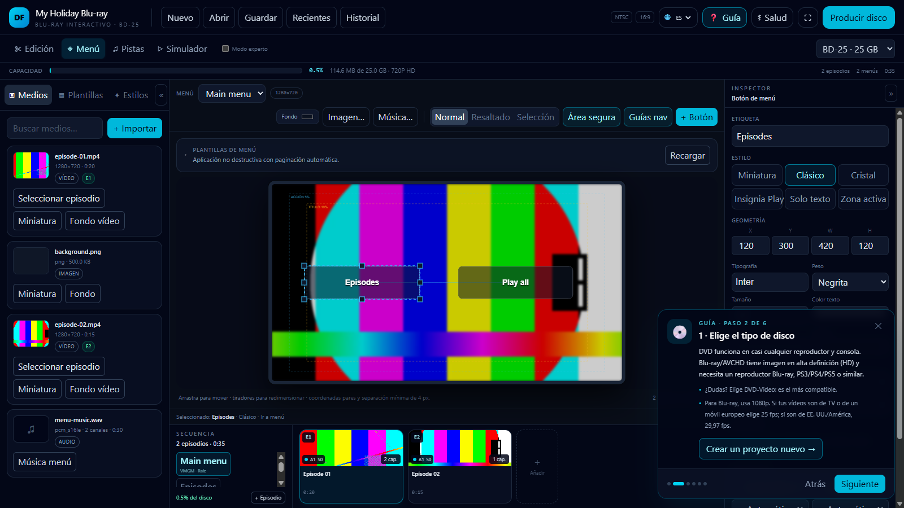
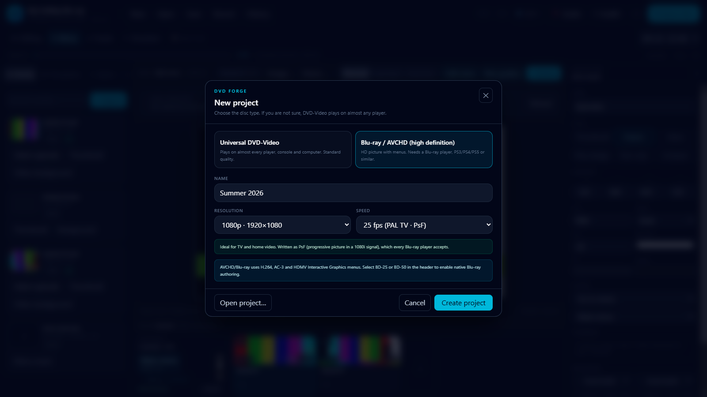
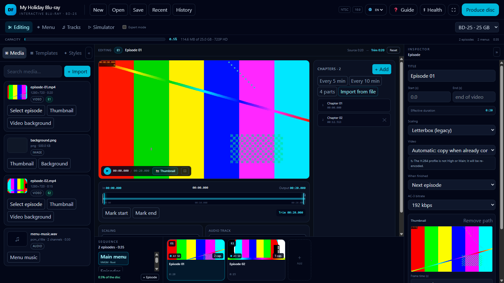
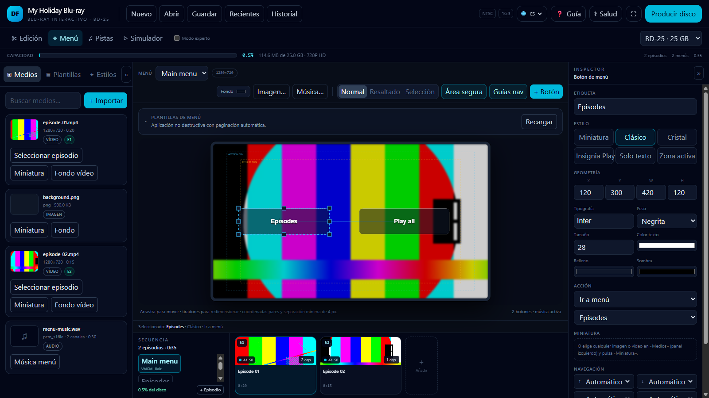
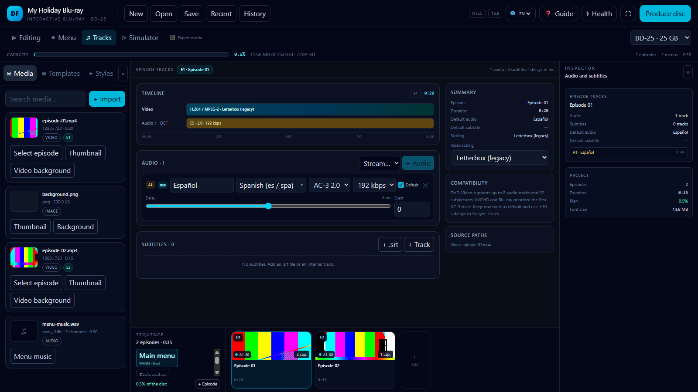
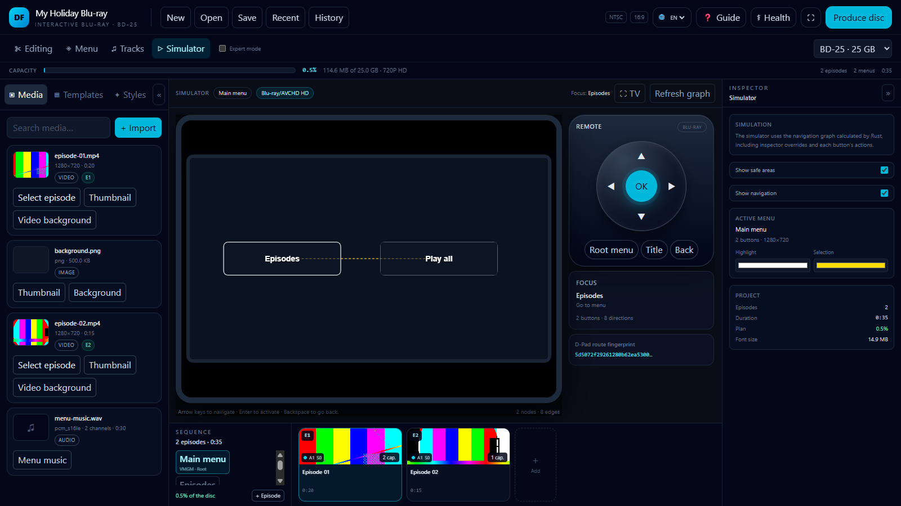
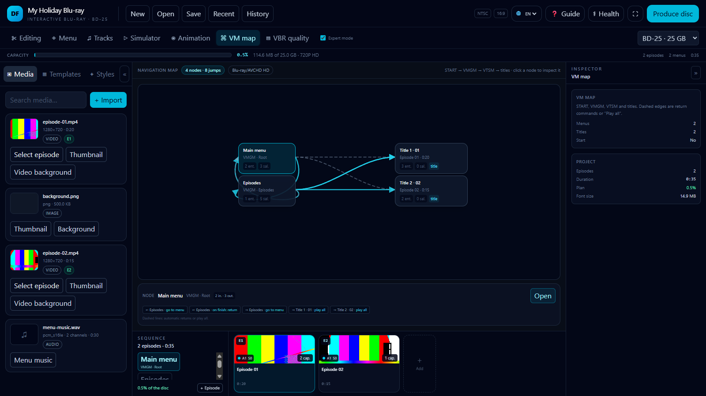
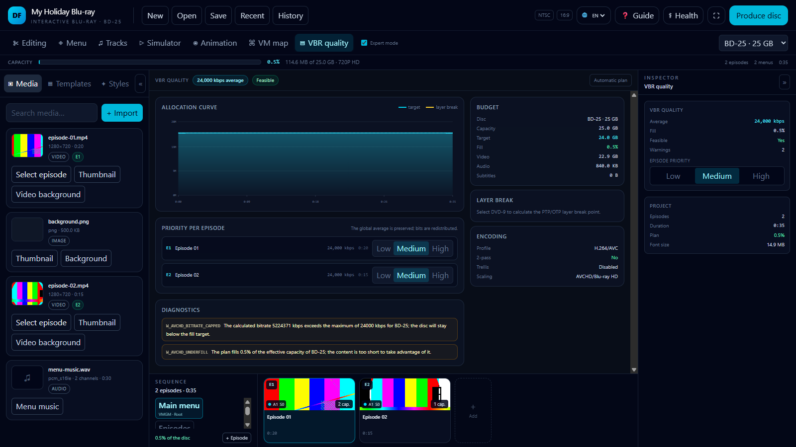

# Guía de uso de DVD Forge

> [English version](USER_GUIDE.md)

Esta guía explica, paso a paso y sin tecnicismos, cómo convertir tus vídeos en
un DVD o un Blu-ray con menú. Dentro de la aplicación tienes la misma ayuda en
el botón **❓ Guía** (arriba a la derecha).

---

## 1. Antes de empezar

DVD Forge usa programas gratuitos para codificar el vídeo. Pulsa **⚕ Salud**
en la cabecera para ver qué está instalado.

| Herramienta | ¿Para qué? | ¿Obligatoria? |
|---|---|---|
| FFmpeg / FFprobe | Analizar y convertir vídeo y audio | Sí |
| DVDAuthor + Spumux | Discos DVD-Video | Solo para DVD |
| tsMuxeR | Blu-ray/AVCHD | No (hay un muxer integrado) |
| xorriso / growisofs | Grabar en Linux | Solo para grabar en Linux |

En **Windows** lo más fácil es **⚕ Salud → Instalar automáticamente**: DVD
Forge descarga FFmpeg, comprueba su SHA-256 y lo instala solo. También puedes
ejecutar `winget install Gyan.FFmpeg`. La grabación usa la función de
Windows (IMAPI2), no hace falta nada más.

Puedes poner los programas en una carpeta `toolchain\` junto al ejecutable de
DVD Forge y los encontrará solo.

## 2. Crear un proyecto

1. Pulsa **Nuevo proyecto**.
2. Elige el tipo de disco:
   - **DVD-Video**: funciona en casi cualquier reproductor, consola y
     ordenador. Calidad estándar. Si dudas, elige este.
   - **Blu-ray / AVCHD**: imagen en alta definición. Necesita un reproductor
     Blu-ray, una PS3/PS4/PS5 o similar. AVCHD es Blu-ray grabado en un DVD
     normal (DVD-5/DVD-9).
3. Para DVD elige **PAL** (Europa, Argentina, Uruguay, Australia…) o **NTSC**
   (EE. UU., México, Japón…). Para Blu-ray elige resolución y velocidad:

| Origen de tus vídeos | Resolución | Velocidad |
|---|---|---|
| Películas, cine | 1080p | 23,976 o 24 fps |
| TV europea / móvil o cámara en 50 Hz | 1080p | 25 fps |
| TV americana / móvil o cámara en 60 Hz | 1080p | 29,97 fps |
| Deportes, videojuegos, cámaras modernas a 50/60 fps | 1080p | 50 o 59,94 fps (*) |
| Grabaciones entrelazadas de cámara HD antigua | 1080i | 25 o 29,97 fps |

(*) 1080p a 50/59,94 es **AVCHD 2.0**: funciona en PS3/PS4/PS5 y reproductores
actuales, pero algunos Blu-ray antiguos no lo reproducen.

25 y 29,97 fps en 1080p se graban como **PsF** (imagen progresiva dentro de una
señal 1080i). Es el método estándar y lo aceptan todos los reproductores.

## 3. Añadir vídeos

1. En el panel izquierdo, pestaña **Medios**, pulsa **+ Importar** y elige tus
   archivos (`.mp4`, `.mkv`, `.mov`, `.m2ts`, `.mts`, `.avi`…).
2. Pulsa **+ Episodio** en cada vídeo que quieras en el disco.
3. Los episodios aparecen en la barra de **Secuencia** (abajo) en el orden en
   que se reproducirán. Usa **‹ ›** para cambiar el orden y **✕** para quitar.

### Recortar y capítulos

En la pestaña **Edición** puedes:

- Marcar el principio (**In**) y el final (**Out**) de cada episodio.
- Añadir capítulos en el punto actual o automáticamente (cada 5/10 minutos).
- Importar los capítulos que ya traiga un MKV/MP4.

### Vídeos que no hace falta recodificar (Blu-ray/AVCHD)

Si un vídeo ya cumple el formato del disco (por ejemplo, archivos `.m2ts`/`.mts`
de una cámara AVCHD, o un MP4 H.264 con la misma resolución y fps del
proyecto), DVD Forge lo **copia sin recodificar**: es mucho más rápido y sin
ninguna pérdida de calidad.

En el **Inspector** (derecha), con el episodio seleccionado, el campo **Vídeo**
muestra la decisión:

- ⚡ *Compatible: se copia sin recodificar.*
- ↻ *Se recodifica* y el motivo (resolución distinta, fps distintos, recorte
  al principio…).

Puedes forzar **Recodificar siempre** o **Copiar sin recodificar**. Para poder
copiar, el episodio no puede estar recortado al principio.

## 4. Diseñar el menú

La pestaña **Menú** muestra la pantalla que verás en la tele.

- **Lo más rápido**: en el panel izquierdo abre **Plantillas** o la galería
  *Plantillas de menú* debajo del lienzo y elige una. DVD Forge crea un botón
  por episodio y, si hay muchos, varias páginas con «Siguiente ›».
- **Fondo**: en **Medios**, pulsa **Fondo** sobre una imagen o un vídeo. En
  Blu-ray el lienzo es de 1920×1080, así que tus imágenes HD se ven tal cual.
- **Música**: en **Medios**, pulsa **Música menú** sobre un audio.
- **Botones**: arrástralos y cambia su tamaño en el lienzo. En el Inspector
  eliges el texto, la fuente (cualquier fuente instalada en tu ordenador; escribe
  para buscar), el color y qué hace el botón.

### Miniaturas de los episodios

- Selecciona el botón del episodio y pulsa **Usar imagen de «…»** en el
  Inspector, o
- pulsa **📸 Elegir el fotograma exacto…**: se abre la Edición; busca el
  momento que te guste y pulsa **📸 Miniatura**. Se actualizan todos los menús
  que muestran ese episodio.
- También puedes elegir cualquier imagen en **Medios** y pulsar **Miniatura**.

### Más pantallas de menú

En la barra de abajo pulsa **+ Pantalla de menú**. Se crea un submenú con un
botón **Volver** y el menú actual recibe un botón que lo abre. Haz doble clic en
el nombre de una pantalla para renombrarla; pasa el ratón y pulsa **✕** para
borrarla.

## 5. Audio y subtítulos

En la pestaña **Pistas**:

- Elige qué pistas de audio van al disco, su idioma y cuál es la principal.
- Añade subtítulos `.srt`, `.ass`, `.ssa` o `.vtt`. Se convierten
  automáticamente al formato del disco.

Si los episodios vienen de archivos distintos (por ejemplo, uno con audio
«inglés» y otro «sin definir»), en Blu-ray/AVCHD DVD Forge adapta las pistas
para que todo el disco sea coherente y te avisa de lo que cambió.

## 6. Probar

La pestaña **Simulador** reproduce el disco como un reproductor real. Usa las
flechas del teclado y **Enter**, o el mando de la pantalla. Si un botón no se
puede alcanzar, aparece un aviso.

## 7. Crear y grabar el disco

1. Mira la **barra de capacidad**: si se pasa del 100 %, usa un disco de doble
   capa (DVD-9, BD-50) o quita contenido.
2. Pulsa **Producir disco**.
3. Elige **Solo ISO** (un archivo que puedes grabar después o probar en VLC) o
   **ISO + grabar** y la grabadora.
4. Antes de grabar, DVD Forge comprueba la estructura del disco. Si encuentra
   un error grave, no graba, para no estropear un disco.

### Llevar o compartir un proyecto

Pulsa **📦 Empaquetar** para guardar el proyecto y todos sus vídeos, audios,
subtítulos y fuentes en un solo archivo `.dvdforge-bundle`. En el otro
ordenador usa **Abrir**, elige el paquete y una carpeta vacía: se comprueba
todo (SHA-256) y se abre el proyecto.

### Si la producción se corta a la mitad

Vuelve a pulsar **Producir disco**: los episodios que ya estaban codificados
se reutilizan, así que continúa en vez de empezar de cero.

## 8. Problemas frecuentes

| Problema | Solución |
|---|---|
| «Falta FFmpeg» | Instálalo (`winget install Gyan.FFmpeg`) y reinicia DVD Forge. |
| El DVD no se genera en Windows | Falta DVDAuthor/Spumux: ponlos en `toolchain\` junto a DVD Forge. Blu-ray/AVCHD no los necesitan. |
| El menú de Blu-ray no aparece | Actualiza a 0.7.0: con FFmpeg 9 el menú se descartaba al generarse sin tsMuxeR. |
| El fondo se ve aplastado | Actualiza a 0.7.0: los menús HD usan ahora un lienzo de 1920×1080. Al abrir un proyecto antiguo se adapta solo. |
| Aviso de audio | Lee el aviso en el registro de producción: DVD Forge indica qué pista ajustó. |
| No sé qué fps elegir | Mira la tabla del apartado 2. |
| Herramientas avanzadas | Activa **Modo experto** (junto a las pestañas) para ver Animación, Mapa VM y Calidad VBR. |

## 9. Modo experto

Activa **Modo experto** junto a las pestañas para ver Animación (menús y
miniaturas en movimiento), el Mapa VM (todos los saltos que puede hacer el
reproductor) y Calidad VBR (bitrate por episodio y presupuesto del disco).

## 10. Idiomas

Cambia el idioma de la interfaz en el selector de la cabecera. Los nombres que
DVD Forge pone por defecto en el disco («Menú principal», «Siguiente ›»…) usan
el idioma de la interfaz.
