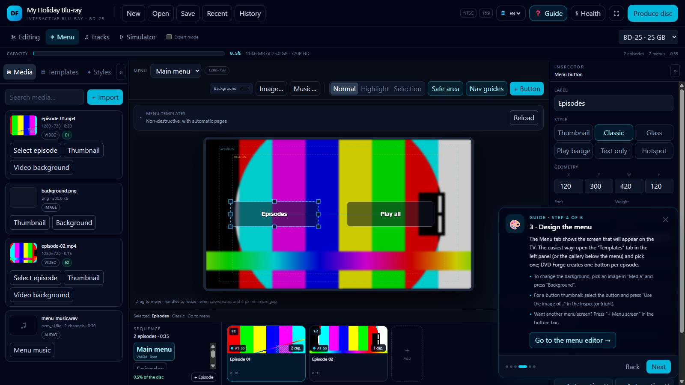
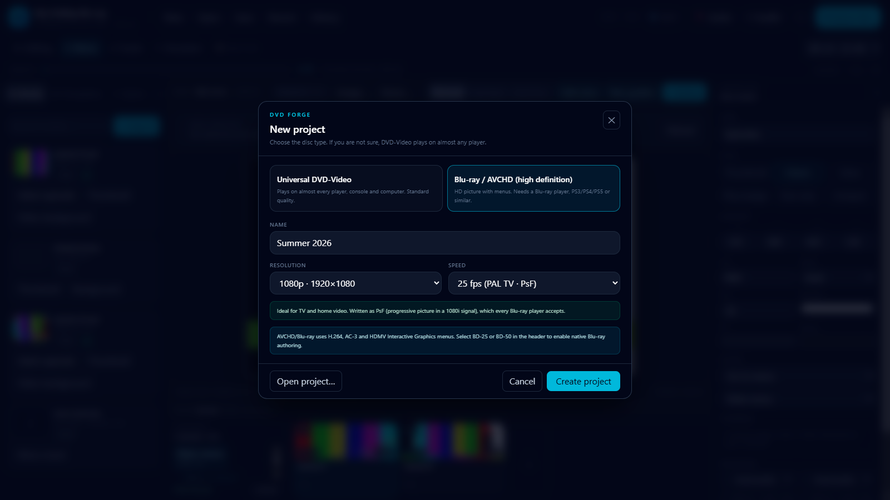
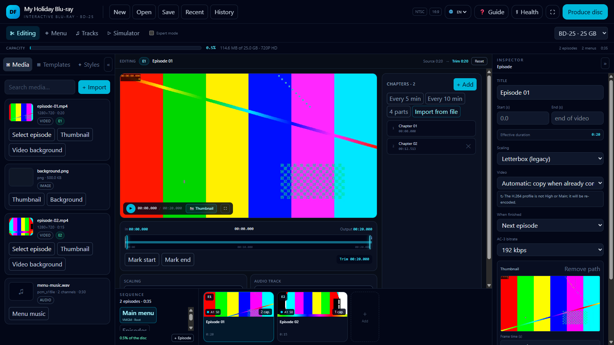
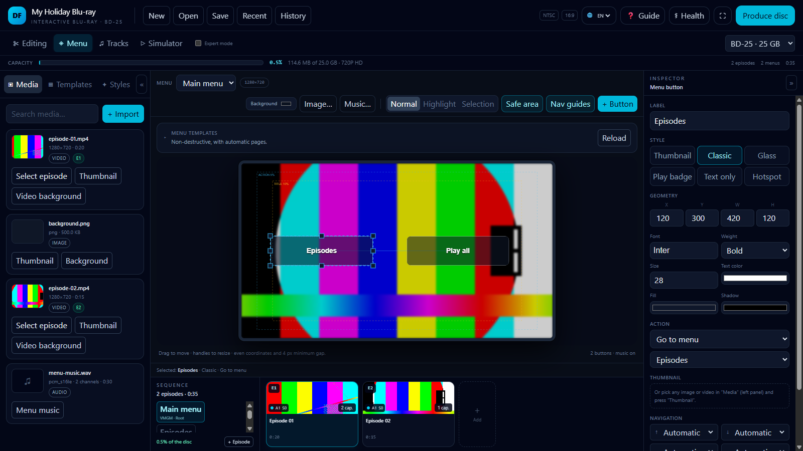
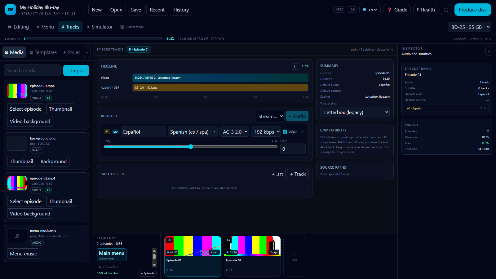
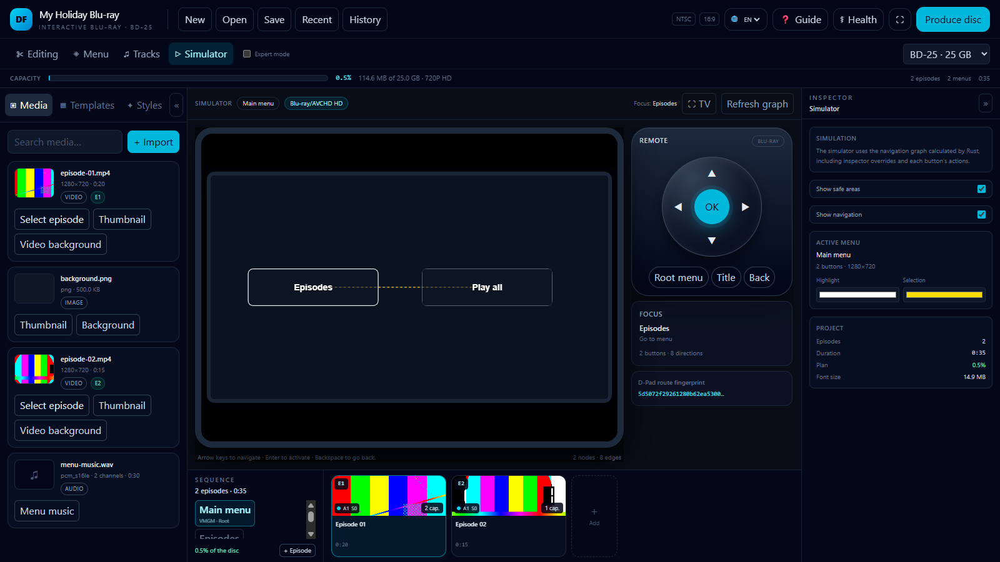
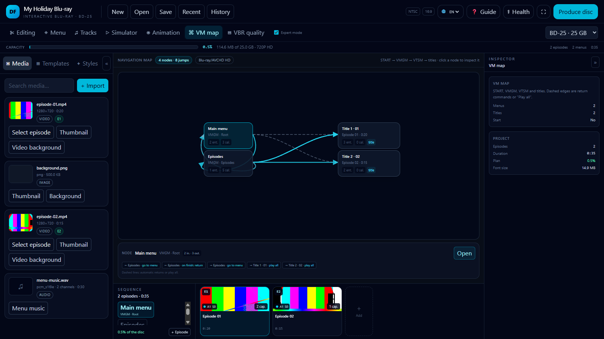
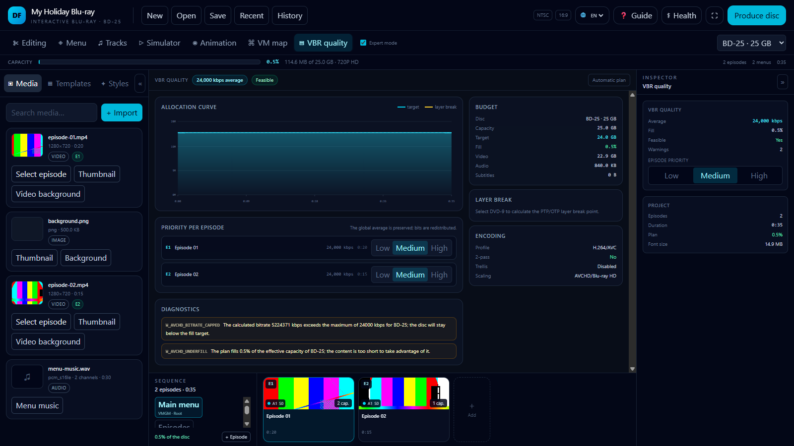

# DVD Forge user guide

> [Versión en español](GUIA-DE-USO.md)

This guide explains, step by step and in plain words, how to turn your videos
into a DVD or Blu-ray with a menu. The same help is available inside the app
with the **❓ Guide** button (top right).

---

## 1. Before you start

DVD Forge uses free tools to encode video. Press **⚕ Health** in the header to
see what is installed.

| Tool | What for | Required? |
|---|---|---|
| FFmpeg / FFprobe | Analyse and convert video and audio | Yes |
| DVDAuthor + Spumux | DVD-Video discs | DVD only |
| tsMuxeR | Blu-ray/AVCHD | No (a built-in muxer is used) |
| xorriso / growisofs | Burning on Linux | Linux burning only |

On **Windows**: `winget install Gyan.FFmpeg`. Burning uses Windows' own API
(IMAPI2); nothing else is needed.

You can put the tools in a `toolchain\` folder next to the DVD Forge executable
and they will be found automatically.

## 2. Create a project

1. Press **New project**.
2. Choose the disc type:
   - **DVD-Video**: plays on almost any player, console and computer. Standard
     quality. If unsure, choose this one.
   - **Blu-ray / AVCHD**: high-definition picture. Needs a Blu-ray player, a
     PS3/PS4/PS5 or similar. AVCHD is Blu-ray written on a regular DVD
     (DVD-5/DVD-9).
3. For DVD choose **PAL** (Europe, Argentina, Australia…) or **NTSC** (USA,
   Mexico, Japan…). For Blu-ray choose resolution and frame rate:

| Where your videos come from | Resolution | Frame rate |
|---|---|---|
| Films, cinema | 1080p | 23.976 or 24 fps |
| European TV / 50 Hz phone or camera | 1080p | 25 fps |
| American TV / 60 Hz phone or camera | 1080p | 29.97 fps |
| Sports, games, modern 50/60 fps cameras | 1080p | 50 or 59.94 fps (*) |
| Interlaced recordings from older HD camcorders | 1080i | 25 or 29.97 fps |

(*) 1080p at 50/59.94 is **AVCHD 2.0**: it plays on PS3/PS4/PS5 and current
players, but some older Blu-ray players cannot play it.

1080p at 25 and 29.97 fps is written as **PsF** (progressive picture inside a
1080i signal). This is the standard method and every player accepts it.

## 3. Add videos

1. In the left panel, **Media** tab, press **+ Import** and choose your files
   (`.mp4`, `.mkv`, `.mov`, `.m2ts`, `.mts`, `.avi`…).
2. Press **+ Episode** on every video you want on the disc.
3. Episodes appear in the **Sequence** bar (bottom) in playback order. Use
   **‹ ›** to reorder and **✕** to remove.

### Trimming and chapters

In the **Editing** tab you can:

- Set the start (**In**) and end (**Out**) of each episode.
- Add chapters at the current position or automatically (every 5/10 minutes).
- Import the chapters already stored in an MKV/MP4.

### Videos that do not need re-encoding (Blu-ray/AVCHD)

When a video already matches the disc format (for example `.m2ts`/`.mts` files
from an AVCHD camcorder, or an H.264 MP4 with the project's resolution and
frame rate), DVD Forge **copies it without re-encoding**: much faster and with
no quality loss.

In the **Inspector** (right), with the episode selected, the **Video** field
shows the decision:

- ⚡ *Compatible: copied without re-encoding.*
- ↻ *Re-encoded* and why (different resolution, different frame rate, start
  trim…).

You can force **Always re-encode** or **Copy without re-encoding**. To be
copied, the episode must not be trimmed at the start.

## 4. Design the menu

The **Menu** tab shows the screen you will see on the TV.

- **Fastest**: open **Templates** in the left panel, or the *Menu templates*
  gallery below the canvas, and pick one. DVD Forge creates one button per
  episode and, when there are many, several pages with “Next ›”.
- **Background**: in **Media**, press **Background** on an image or video. On
  Blu-ray the canvas is 1920×1080, so your HD artwork is shown 1:1.
- **Music**: in **Media**, press **Menu music** on an audio file.
- **Buttons**: drag and resize them on the canvas. In the Inspector choose the
  text, the font (any font installed on your computer; type to search), the
  colour and what the button does.

### Episode thumbnails

- Select the episode button and press **Use the image of “…”** in the
  Inspector, or
- press **📸 Pick the exact frame…**: Editing opens; find the moment you like
  and press **📸 Thumbnail**. Every menu showing that episode is updated.
- You can also pick any image in **Media** and press **Thumbnail**.

### More menu screens

In the bottom bar press **+ Menu screen**. A submenu is created with a **Back**
button, and the current menu gets a button that opens it. Double-click a screen
name to rename it; hover it and press **✕** to delete it.

## 5. Audio and subtitles

In the **Tracks** tab:

- Choose which audio tracks go on the disc, their language and the main one.
- Add `.srt`, `.ass`, `.ssa` or `.vtt` subtitles. They are converted to the disc
  format automatically.

When episodes come from different files (for example one with “English” audio
and one “undetermined”), on Blu-ray/AVCHD DVD Forge adapts the tracks so the
whole disc is consistent and tells you what changed.

## 6. Test

The **Simulator** tab plays the disc like a real player. Use the keyboard
arrows and **Enter**, or the on-screen remote. If a button cannot be reached, a
warning appears.

## 7. Create and burn the disc

1. Check the **capacity bar**: above 100 %, use a dual-layer disc (DVD-9,
   BD-50) or remove content.
2. Press **Produce disc**.
3. Choose **ISO only** (a file you can burn later or test in VLC) or
   **ISO + burn** and the burner.
4. Before burning, DVD Forge checks the disc structure. If it finds a blocking
   error it does not burn, so no disc is wasted.

## 8. Common problems

| Problem | Solution |
|---|---|
| “FFmpeg missing” | Install it (`winget install Gyan.FFmpeg`) and restart DVD Forge. |
| DVD is not produced on Windows | DVDAuthor/Spumux are missing: put them in `toolchain\` next to DVD Forge. Blu-ray/AVCHD do not need them. |
| Blu-ray menu does not appear | Update to 0.7.0: with FFmpeg 9 the menu was dropped when tsMuxeR was absent. |
| Background looks squeezed | Update to 0.7.0: HD menus now use a 1920×1080 canvas. Older projects are adapted when opened. |
| Audio warning | Read the warning in the production log: DVD Forge says which track it adjusted. |
| Not sure which frame rate | See the table in section 2. |
| Advanced tools | Turn on **Expert mode** (next to the tabs) to see Animation, VM map and VBR quality. |

## 9. Expert mode

Turn on **Expert mode** next to the tabs to see Animation (moving menus and
thumbnails), the VM map (every jump the player can make) and VBR quality
(bitrate per episode and disc budget).

## 10. Languages

Change the interface language with the selector in the header. The default
names DVD Forge puts on the disc (“Main menu”, “Next ›”…) follow the interface
language.
